<h1 align="center">CyberConcept</h1>

<p align="center">Las siglas de ciberseguridad que siempre se te escapan, practicadas hasta que se queden.</p>

<p align="center">
  <a href="https://mariourenagarcia.github.io/CyberConcept/"><strong>Abrir la página</strong></a>
</p>

<p align="center">
  <a href="https://mariourenagarcia.github.io/CyberConcept/">
    
  </a>
</p>

Aparecen unas siglas y escribes lo que significan. O al revés. O eliges entre cuatro opciones. Con más de 300 acrónimos organizados en 11 categorías y temas, para que practiques justo lo que te cuesta.

## Modos

| Modo | Cómo funciona |
| --- | --- |
| Escribir | Ves las siglas y escribes el significado completo. Un marcador en vivo colorea cada letra en verde o rojo mientras escribes. |
| Opción múltiple | Ves las siglas y eliges entre cuatro significados. Los distractores salen de la misma categoría. |
| Inverso | Ves el significado y la descripción, y escribes las siglas. |
| Mixto | Las tres dinámicas mezcladas al azar. |

Al escribir se acepta cualquier forma razonable: sin acentos, sin guiones, sin importar mayúsculas y con pequeñas erratas.

## Funciones

- Filtro por categorías y por temas dentro de cada categoría.
- Sesiones de 10, 20, 40 o todas las preguntas, o modo infinito hasta que decidas parar.
- Tiempo opcional por pregunta.
- Cinco niveles de pista que van abriendo huecos de cada palabra.
- Prioridad automática para los acrónimos fallados o nunca vistos.
- Resumen al final con tira de aciertos, precisión, racha y repaso de los fallos.
- Glosario con búsqueda y vista de progreso por categoría.
- Tema claro y oscuro, diseño para móvil y atajos de teclado: Enter para comprobar y avanzar, 1 a 4 para elegir opción, Alt+H para pista.

El progreso se guarda en el almacenamiento local del navegador. No hay servidor ni cuentas.

## Categorías

Redes y protocolos, criptografía, identidad y acceso, ataques, malware y vulnerabilidades, defensa y operaciones, aplicaciones y desarrollo seguro, nube y DevSecOps, gobierno, riesgo y cumplimiento, respuesta a incidentes y pentesting, sistemas, hardware e industrial, y organizaciones y certificaciones.

## Uso local

Es un sitio estático sin dependencias. Basta con servir la carpeta con cualquier servidor de archivos:

```
python -m http.server 8765
```

y abrir `http://localhost:8765`.

## Estructura

- `index.html`: estructura de la página e íconos SVG.
- `css/styles.css`: estilos, tema claro y oscuro, diseño responsivo.
- `js/data.js`: categorías y banco de acrónimos.
- `js/app.js`: lógica de práctica, glosario y progreso.
- `docs/demo.svg`: la demostración animada de este README.

## Agregar acrónimos

Añade una entrada en `js/data.js` con sus siglas (`a`), significado (`e`), descripción (`d`), categoría (`c`), tema (`t`) y, si aplica, otras respuestas aceptadas (`alt`):

```js
{ a: "SIEM", e: "Security Information and Event Management", d: "Plataforma que centraliza, correlaciona y alerta sobre registros de seguridad.", c: "defensa", t: "Detección y respuesta" }
```

Los temas nuevos aparecen solos en los filtros; las categorías se definen en la lista `CATEGORIES` del mismo archivo.
